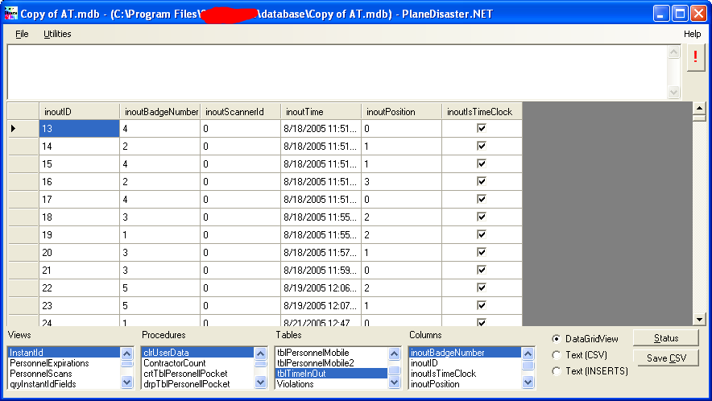

# PlaneDisaster.NET

PlaneDisaster.NET is a .NET database front end for JetSQL (the Microsoft Access file format) and SQLite. Besides browsing and querying, it can create new Access and SQLite files, and compact and repair Access databases.



## What's in the solution

| Project | What it is |
| --- | --- |
| `PlaneDisaster` | The Windows Forms application |
| `PlaneDisaster.Dba` | Data access for Access (OleDb and ODBC) and SQLite |
| `Jet2SQLite` | A tool that copies an Access database into SQLite |
| `jsql_admin` | A command line tool that creates an Access database (`-c -d file.mdb`) and runs a SQL script against it (`-s script.sql`) |
| `UnitTests` | NUnit 2.6 tests |
| `PlaneDisaster.NET Setup` | The WiX installer |

## Building

The projects target .NET Framework 2.0, with x86 and x64 platforms. CI builds them with MSBuild on `windows-latest`; see [`.github/workflows/build.yml`](.github/workflows/build.yml) for the exact commands. In short, from a Visual Studio developer prompt:

```powershell
msbuild PlaneDisaster.NET.sln -p:Configuration=Release -p:Platform=x64 -p:RestorePackages=false
```

If .NET Framework 3.5 isn't installed, add the `TargetFrameworkRootPath` and `FrameworkPathOverride` arguments from the workflow, which point MSBuild at the `Microsoft.NETFramework.ReferenceAssemblies.net20` package.

Opening Access files needs an Access driver. 32 bit builds use Jet 4.0, which ships with Windows. 64 bit builds need the [Microsoft Access Database Engine 2016 Redistributable](https://www.microsoft.com/en-us/download/details.aspx?id=54920).

## License

GPL version 2. See [gpl.txt](gpl.txt).
